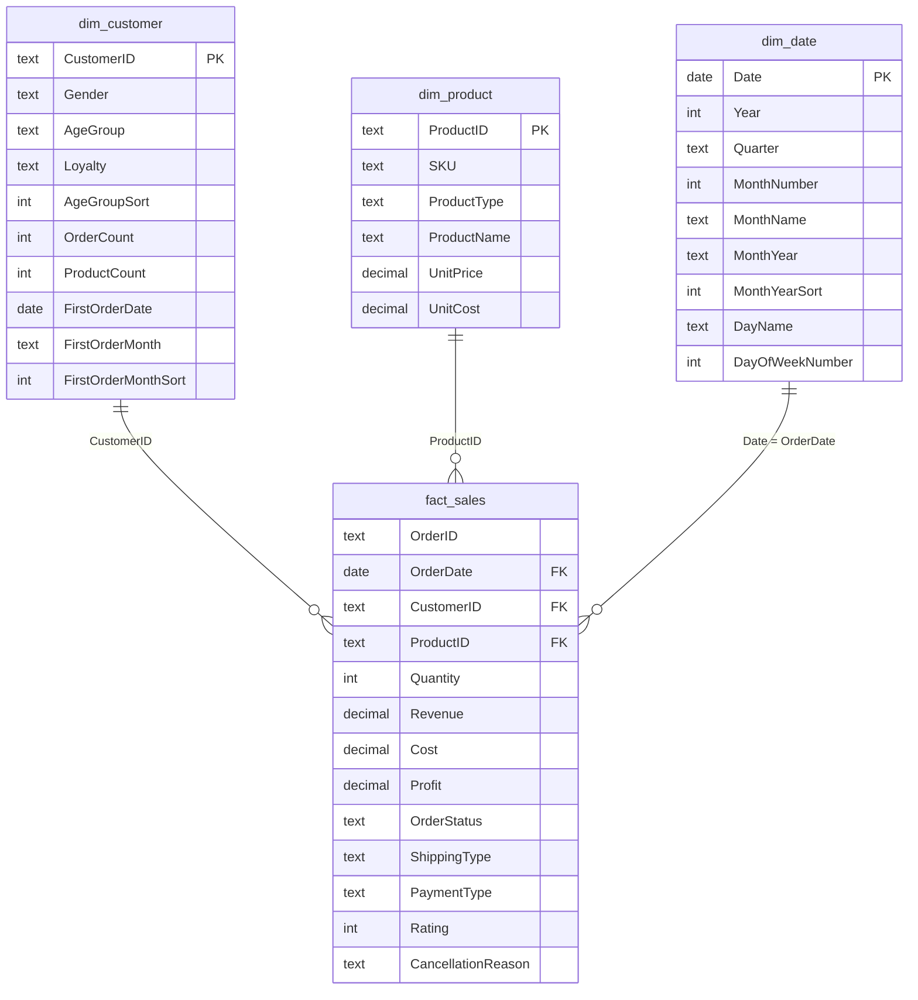

# Model Notes

Ghi chú về mô hình dữ liệu của dashboard **Sales Performance Dashboard**: cấu trúc bảng, quan hệ, các quyết định thiết kế, giới hạn cần biết và cách đối soát số liệu. Ảnh sơ đồ mô hình (chụp từ Model view) đặt cùng thư mục với tên `star_schema.png`.

## 1. Tổng quan

Mô hình theo kiểu star schema: một bảng sự kiện `fact_sales` ở giữa, ba bảng chiều bao quanh. Các measure nằm trong một bảng riêng `_Measures`, ngoài ra có hai bảng phụ không nối quan hệ (`Month Index`, `Parameter`).

Sơ đồ chỉ liệt kê các cột chính của `dim_date` (bảng có 14 cột, xem `power_query/M_scripts.md`).

## 2. Các bảng trong mô hình

| Bảng | Loại | Số dòng | Số cột | Nguồn | Mô tả |
|---|---|---|---|---|---|
| `fact_sales` | Fact | 20.000 | 13 | CSV (Power Query) | Mỗi dòng là một đơn hàng gồm một sản phẩm. `OrderID` duy nhất ở mọi dòng nên đóng vai trò degenerate dimension |
| `dim_customer` | Dimension | 12.136 | 10 | CSV (loại trùng) + cột DAX | Thuộc tính khách hàng và các cột hành vi tính sẵn |
| `dim_product` | Dimension | 16 | 6 | CSV (loại trùng) | Danh mục 16 SKU, 5 nhóm sản phẩm, kèm đơn giá và giá vốn |
| `dim_date` | Dimension | 1.461 | 14 | Tạo bằng Power Query | Bảng lịch 01/01/2022 đến 31/12/2025 |
| `_Measures` | Bảng chứa measure | 1 (trống) | 1 | DAX | Chứa 55 measure; cột `Placeholder` chỉ để bảng tồn tại |
| `Month Index` | Bảng phụ | 13 | 1 | DAX | Số nguyên 0 đến 12, làm trục cột cho ma trận cohort; không có quan hệ |
| `Parameter` | Field parameter | 4 | 3 | DAX | Cho người xem đổi chỉ số (Profit, Revenue, Cost, Units Sold) ở biểu đồ đường trang Product |

## 3. Quan hệ

| # | Từ (bảng nhiều) | Đến (bảng một) | Cardinality | Hướng lọc | Trạng thái |
|---|---|---|---|---|---|
| 1 | `fact_sales[CustomerID]` | `dim_customer[CustomerID]` | Nhiều-một (M:1) | Một chiều (dim -> fact) | Hoạt động |
| 2 | `fact_sales[ProductID]` | `dim_product[ProductID]` | Nhiều-một (M:1) | Một chiều (dim -> fact) | Hoạt động |
| 3 | `fact_sales[OrderDate]` | `dim_date[Date]` | Nhiều-một (M:1) | Một chiều (dim -> fact) | Hoạt động |

- Chỉ có một quan hệ tới `dim_date` (theo ngày đặt hàng) vì dữ liệu không có ngày giao hàng, nên không cần `USERELATIONSHIP`.
- Toàn bộ quan hệ là một chiều, không dùng lọc hai chiều, để tránh mơ hồ và giữ hiệu năng.
- Không có khóa mồ côi: mọi `CustomerID` và `ProductID` trong `fact_sales` đều có trong bảng chiều tương ứng, và ngược lại.

## 4. Quyết định thiết kế

| Quyết định | Lý do |
|---|---|
| Tách một file CSV phẳng thành fact + 3 dim | Giảm lặp dữ liệu (thuộc tính khách và sản phẩm lặp ở từng đơn), cho phép lọc chéo giữa các bảng chiều và dùng được các hàm time intelligence |
| Giữ `OrderStatus`, `ShippingType`, `PaymentType`, `CancellationReason` trong `fact_sales` | Mỗi cột chỉ có 2 đến 6 giá trị; tách thành bảng riêng chỉ thêm quan hệ mà không có thêm thuộc tính nào. Slicer dùng trực tiếp các cột này |
| `dim_date` tạo bằng M, phủ 2022 đến 2025 | Bảng lịch liên tục là điều kiện của `DATEADD` và `TOTALYTD`; khoảng ngày rộng hơn dữ liệu (09/2023 đến 09/2024) để các phép so sánh tháng trước không bị cắt ở biên |
| `AgeGroupSort` tạo ở Power Query, không dùng cột DAX | Cột này dùng để sắp xếp `AgeGroup` theo thứ tự tuổi; tạo bằng DAX gây lỗi phụ thuộc vòng khi đặt làm cột sắp xếp |
| `Month Index` là bảng không quan hệ | Measure `Cohort Retention %` đọc giá trị offset bằng `SELECTEDVALUE`; bảng này chỉ cung cấp trục cột cho ma trận |
| Bảng `_Measures` riêng | Gom toàn bộ measure vào một chỗ, chia display folder theo trang (00 Base, 01 Overview, 02 Product, 03 Customer) |
| Field parameter `Parameter` | Một biểu đồ đường thay cho bốn biểu đồ, người xem tự chọn chỉ số |
| Cột `Revenue`, `Cost`, `Profit` giữ nguyên từ nguồn | Đã kiểm tra: `Revenue = Quantity × UnitPrice`, `Cost = Quantity × UnitCost`, `Profit = Revenue − Cost` khớp 100%, nên không cần tính lại |

## 5. Cột tính toán trong `dim_customer`

Năm cột dưới đây tính bằng DAX và dùng `CALCULATE` trên `fact_sales` (chuyển ngữ cảnh dòng sang ngữ cảnh lọc qua quan hệ số 1).

| Cột | Công thức | Dùng ở đâu |
|---|---|---|
| `OrderCount` | `CALCULATE(COUNTROWS(fact_sales))` | Biểu đồ "Distribution by order count" |
| `ProductCount` | `CALCULATE(DISTINCTCOUNT(fact_sales[ProductID]))` | Biểu đồ "Customer distribution by product count" |
| `FirstOrderDate` | `CALCULATE(MIN(fact_sales[OrderDate]))` | Xác định cohort và measure `Cohort Retention %` |
| `FirstOrderMonth` | `FORMAT([FirstOrderDate], "MMM YYYY")` | Trục hàng của ma trận cohort |
| `FirstOrderMonthSort` | `YEAR(...) * 100 + MONTH(...)` | Cột sắp xếp cho `FirstOrderMonth` |

## 6. Cột sắp xếp (Sort by column)

| Cột hiển thị | Sắp xếp theo | Bảng |
|---|---|---|
| `MonthYear` ("Sep 2023") | `MonthYearSort` (202309) | `dim_date` |
| `DayName` | `DayOfWeekNumber` | `dim_date` |
| `AgeGroup` | `AgeGroupSort` | `dim_customer` |
| `FirstOrderMonth` | `FirstOrderMonthSort` | `dim_customer` |
| `Parameter Fields` | `Parameter Order` | `Parameter` |

Đây là cấu hình theo thiết kế của các cột `...Sort` / `...Number` / `Order`. Khi mở file cần kiểm tra lại trong Model view (**Column tools -> Sort by column**), vì nếu thiếu, biểu đồ sẽ sắp theo thứ tự chữ cái (ví dụ "Apr 2024" đứng trước "Sep 2023").

## 7. Giới hạn của mô hình cần biết

1. **Doanh thu và lợi nhuận gồm cả đơn bị hủy.** `Total Revenue` và `Total Profit` là `SUM` không lọc `OrderStatus`. Với toàn bộ dữ liệu, doanh thu hiển thị là 58,7 triệu, trong khi chỉ đơn `Completed` là 39,2 triệu. Dashboard có slicer `OrderStatus` để người xem tự lọc.
2. **Cột tính toán của `dim_customer` cố định tại thời điểm refresh.** `OrderCount`, `ProductCount`, `FirstOrderDate` được tính trên toàn bộ dữ liệu, không đổi theo slicer ngày hay trạng thái. Vì vậy hai biểu đồ phân bố theo số đơn và số sản phẩm cho thấy hành vi cả vòng đời của khách, trong khi giá trị đo `Total Customers` vẫn phản ứng với slicer.
3. **Cohort tính cả đơn bị hủy.** `FirstOrderDate` lấy ngày đơn đầu tiên bất kể trạng thái, và một khách được coi là "quay lại" nếu có bất kỳ đơn nào trong tháng đó. Measure `Cohort Retention %` cũng bỏ qua slicer ngày (`REMOVEFILTERS(dim_date)`) nhưng vẫn nhận các slicer khác.
4. **Tháng 09/2024 chưa đủ.** Dữ liệu dừng ở 23/09/2024, nên các chỉ số MoM của tháng này bị lệch xuống. Trong cohort, các ô vượt quá ngày dữ liệu cuối được trả về trống thay vì 0%.
5. **`Active Customer Rate` luôn bằng 100% khi xem toàn kỳ**, vì mọi khách trong `dim_customer` đều có ít nhất một đơn.
6. **Nhãn `Loyalty` đến từ dữ liệu nguồn**, chưa được tính từ hành vi (RFM) trong mô hình.
7. **Bảng ngày tự động còn trong file.** Mô hình đang có các bảng `DateTableTemplate_...` và `LocalDateTable_...` do tính năng Auto date/time tạo ra. Nên tắt tính năng này (**File -> Options -> Current file -> Data Load**) và chỉ dùng `dim_date`.

## 8. Đối soát số liệu

Dùng bảng dưới để kiểm tra mô hình sau khi refresh hoặc khi đổi máy. Mọi giá trị tính khi không áp dụng slicer nào.

| Chỉ số | Measure | Giá trị mong đợi |
|---|---|---|
| Số đơn | `Total Orders` | 20.000 |
| Số khách | `Total Customers` | 12.136 |
| Doanh thu | `Total Revenue` | 58.708.772,25 |
| Chi phí | `Total Cost` | 12.480.915,55 |
| Lợi nhuận | `Total Profit` | 46.227.856,70 |
| Biên lợi nhuận | `Profit Margin %` | 78,74% |
| Số sản phẩm bán ra | `Total Units Sold` | 110.365 |
| Số đơn hoàn thành / bị hủy | `Completed Orders` / `Cancelled Orders` | 13.435 / 6.565 |
| Tỷ lệ hủy | `Cancellation Rate` | 32,83% |
| Rating trung bình | `Average Rating` | 3,13 |
| Khách quay lại | `Repeat Customers` | 5.124 (42,2% số khách) |
| Tần suất mua | `Frequency` | 1,65 đơn/khách |
| Doanh thu mỗi khách | `Revenue per Customer` | 4.837,57 |
| Doanh thu đơn Completed (lọc `OrderStatus = Completed`) | `Total Revenue` | 39.192.978,85 |

Hai đẳng thức cần luôn đúng: `Total Revenue − Total Cost = Total Profit`, và `Completed Orders + Cancelled Orders = Total Orders`.

## 9. Checklist khi mở hoặc refresh mô hình

1. Tạo hoặc cập nhật tham số `FilePath` trỏ tới `data/raw/Sales_Performance_Raw_data.csv`.
2. Refresh toàn bộ dữ liệu, rồi đối soát với bảng ở mục 8.
3. Kiểm tra `dim_date` đã được Mark as date table trên cột `Date`.
4. Kiểm tra các cột sắp xếp ở mục 6.
5. Kiểm tra cả ba quan hệ ở mục 3 đang hoạt động, một chiều.
6. Kiểm tra các thẻ MoM không trả về 0,0% hay trống khi chọn một tháng giữa kỳ.
